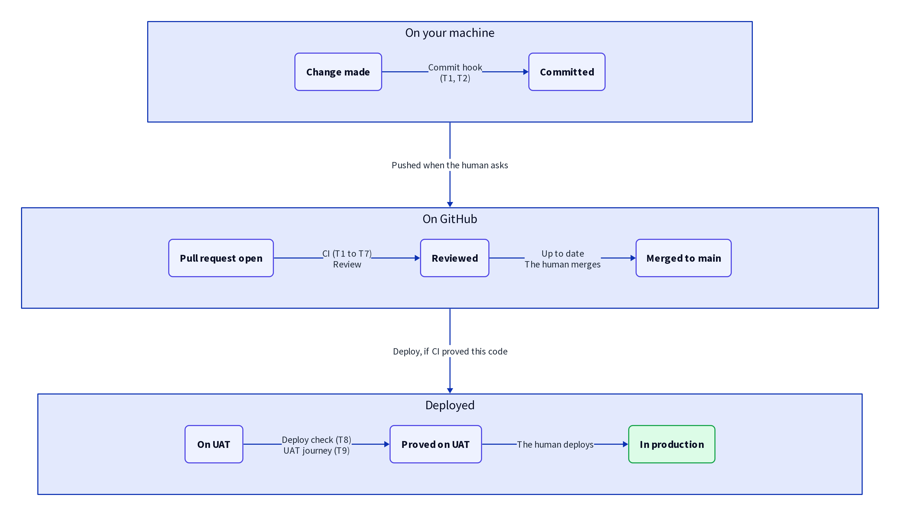

<!--
WORKED EXAMPLE, 12 Nov 2026. What a repo's AGENTS.md could look like under the
new layout, filled in with Connect Assist's rules as they stand today so the
shape can be judged. It is not a template yet, and it changes no repo.
-->

# Agent instructions

Connect Assist is a multi-tenant web application that runs anonymous employee-feedback questionnaires.

## Skills

Load the skill when its moment comes. Each one holds its own procedure; nothing here repeats it.

| When | Skill | What it is for | Who uses it |
| --- | --- | --- | --- |
| Deciding what to build | `grill-with-docs` | Questions an idea against the project's vocabulary and past decisions until it is clear. | You, with the human |
| | `to-prd` | Writes the agreed idea up as a requirements document. | You |
| | `to-issues` | Breaks a plan into tickets that can each be picked up alone. | You |
| Building | `stream` | Optional. For several tickets planned as one piece of work: a parent ticket that gives one session a place to coordinate and record them. Also holds the check to make before starting any ticket. | You, as orchestrator |
| | `review-code-change` | Reviews a finished change with fresh reviewers. | Subagents you send |
| | `verify-frontend-change` | Checks a visible change by using the real app. | A subagent you send |
| Any time | `linear` | Everything about tickets: statuses, labels, what a good ticket holds. | Anyone who touches a ticket |
| | `session-wrap-up` | When the human is wrapping up: proposes what from the session is worth keeping. | You, with the human |
| | `handoff` | When a session ends with work unfinished: writes the note for the next one. | You |

## Subagents

A subagent is a separate agent you send to do one job and report back. You send all of them; none of them sends another.

| Subagent | What it does | What it works from |
| --- | --- | --- |
| Builder | Builds the tickets in its brief, tests first, in its own worktree. The brief may be one ticket or one lane of a stream. | The builder file. Test-driven development. `diagnose` when something fails unexpectedly. The handbook chapters its tickets name. |
| Ticket reviewer | Checks a finished change against its ticket, its tests and the standards. | `review-code-change`. The handbook. |
| Bug hunter | Reads only the code of a finished change, looking for bugs. | `review-code-change`. |
| Frontend verifier | Drives the real app through the journeys a change affects. | `verify-frontend-change`. |

None of them changes a ticket's status. None of them writes to a context file, except a builder landing an ADR change carried in its brief. They report to you, and you decide what happens next.

## Context files

These are the files that explain the project. Read the ones your task touches.

| File | What it holds |
| --- | --- |
| `AGENTS.md` | This file: what every session needs before any task. |
| `CONTEXT.md` | The vocabulary: each term of the product and what it means. |
| `docs/adr/` | Architecture decision records (ADRs): one file per decision that is hard to reverse, with its reason and the options turned down. |
| `docs/decisions.md` | Rulings the human made that no ADR covers, one line each. |
| `docs/pitfalls.md` | Traps in this repo that cost time and will recur, one line each. |
| `docs/agents/domain.md` | The rules for all of the above: what belongs in each file and what does not. |
| `README.md` | What the project is and how to get it running. |

**Ask the human first, every time,** before you:
- add to, change or remove anything in any of these files, this one included;
- create a new context file, ADR, planning document or folder for them;
- start any new way of keeping context, such as a notes file, a log or a memory scheme.

The one exception is an ADR: when a ticket or plan the human approved carries the exact new wording, land it unchanged without asking again. Code files and folders need no permission.

## How work is done

Work is in one of two modes. Each is a short path, and each step names the skill or subagent from the tables above.

### Deciding what to build

| Step | What happens | Skill |
| --- | --- | --- |
| 1. Question it | You and the human question the idea until it is clear. The vocabulary and the ADRs are updated as decisions are made, with the human there. | `grill-with-docs` |
| 2. Write it up | The agreed idea becomes a requirements document. | `to-prd` |
| 3. Break it down | The plan becomes tickets, which wait in Backlog. | `to-issues`, `linear` |
| 4. Choose | The human picks what to start. Nothing starts without that. | |

### Building

| Step | What happens | Who | Skill |
| --- | --- | --- | --- |
| 1. Check | Make sure no other session is working on the same ground, and re-audit the ticket. | You | `stream`, `linear` |
| 2. Set up | A worktree and a branch for the work. | You | |
| 3. Build | Tests first, then the code, with evidence that it works. | You, or a builder | |
| 4. Pull request | Opened when the human says to push. CI runs. | You | |
| 5. Review | The ticket reviewer and the bug hunter, at the same time. The frontend verifier too, for a visible change. | Subagents | `review-code-change`, `verify-frontend-change` |
| 6. Fix | Each round of fixes goes to a fresh builder, and the same reviewer checks the fix. | A builder | `stream` |
| 7. Merge | Once CI is green and the review is clean. | The human | |
| 8. Prove | The change is deployed to UAT and proved there, with the evidence on the ticket. Then the ticket is finished. | You | `linear` |

**A ticket goes through those steps by itself.** That is the normal case. If the human gives you another ticket when one is finished, carry on with it the same way.

**A stream is optional.** Offer one when the human plans several tickets as one piece of work, or hands you several at once. Do not start one just because a second ticket follows the first.

A stream is a parent ticket with the work's tickets beneath it. It gives one session, the orchestrator, a place to coordinate and record the work, and it is how one session finishes many tickets without supervision. As orchestrator you split the tickets into lanes, and each lane goes through steps 2 to 6 with its own builder. A lane is one builder, one branch and one pull request, and may hold several tickets. The stream is finished when every review finding is fixed, dropped or settled by the human.

### Tickets

Product work always has a ticket. Changes to agent tooling (skills, this file, hooks) have none. This repo's tickets are in the Linear team **Connect Assist**, prefix **CON**. For everything else about tickets, load the `linear` skill.

### Worktrees

A worktree is a second working folder on its own branch, sharing the repo's history. It is how several agents build at once without treading on each other.

- All building happens in a worktree, never in the main folder. The main folder stays on `main`.
- One branch, one worktree, one pull request.
- Worktrees live in `.claude/worktrees/`, named for the ticket: `.claude/worktrees/con-123`.
- A worktree you did not start in belongs to another session. Leave it alone.
- Run `pnpm install` in every new worktree, or the commit hook will not exist there.

## Git

**What will stop you.** These are checked by a machine.

| Rule | What checks it |
| --- | --- |
| Every change reaches `main` through a pull request. | GitHub branch protection |
| CI is green before a merge. | GitHub branch protection |
| Formatting, lint and type checks pass on what you changed. | The commit hook, on every commit |
| The full test suite passes. | CI, on every pull request |
| Only a commit that CI has proved can be deployed. | The deploy workflow |

**What nothing will stop.** These rest on you.

| Rule | |
| --- | --- |
| Branches | Cut from `origin/main`. Named `<user>/<ticket-id>-<slug>`, main ticket first. |
| Up to date | Bring the branch up to date with `main` before a merge, so `main` only ever holds changes that were tested together. GitHub allows a merge without it, and the deploy then refuses the result. Each merge puts every other open pull request out of date, so finish one before bringing the next up to date. |
| Pushing | Only when the human asks. |
| Merging | The human merges. Open the pull request and stop. |
| Local tests | None are needed before a push. CI runs the full suite. |

Never:
- skip the commit hook with `--no-verify`;
- force-push, or run `git reset --hard` or `git clean` on a shared branch;
- commit with no branch checked out;
- add a line crediting an AI to a commit.

## CI/CD and environments

**Stage: live, with real customers.** A project starts with one environment and adds more as there is more to protect.

### The environments

| Environment | What it is for | What data it holds | How a change gets there | What you may do there |
| --- | --- | --- | --- | --- |
| Local | Development and the test suites. | Made-up data from a seed script. Nothing leaves the machine. | You run it. | Anything. |
| UAT | Proving a change in the deployed app before customers get it. | Standing test organisations and logins. No customer data. | A deploy, started by hand. | Sign in with the test logins and use the app. Start a deploy. Never delete a standing fixture. |
| Production | Customers. | Customer data. No test accounts. | A deploy the human starts, after UAT. | Nothing, unless the human asks. |

Never change infrastructure by hand in any environment.

### The route a change takes

The rules along this route are in Git, above. The tests it names (T1 to T9) are in the next table. The picture is drawn from `example_pipeline.d2`.

### The tests

| # | Suite | What it proves |
| --- | --- | --- |
| T1 | Format and lint | The code follows the house style and avoids common mistakes. |
| T2 | Type check | The types agree across the API and the web app. |
| T3 | Unit tests | One module's logic is right, with nothing else running. |
| T4 | Integration tests | Features work against a real database, including that one organisation cannot see another's rows. |
| T5 | Web tests | The web app's components and client logic work. |
| T6 | Browser tests | Whole journeys work in the built app, driven through a real browser. |
| T7 | Dependency audit | No dependency has a known security hole. |
| T8 | Deploy check | After a deploy to UAT, the app starts and a test user can sign in. |
| T9 | UAT journey | The change itself works in the deployed app. An agent does this by hand and puts screenshots on the ticket. |

### What runs when

| | On a commit | On a pull request | On a deploy to UAT | After a deploy to UAT |
| --- | :---: | :---: | :---: | :---: |
| T1 Format and lint | ● changed files | ● | | |
| T2 Type check | ● changed packages | ● | | |
| T3 Unit tests | | ● | | |
| T4 Integration tests | | ● | | |
| T5 Web tests | | ● | | |
| T6 Browser tests | | ● | | |
| T7 Dependency audit | | ● | | |
| T8 Deploy check | | | ● | |
| T9 UAT journey | | | | ● feature work |

Nothing runs on a merge or on a schedule. A deploy to production re-runs no tests: it checks that CI proved the code.

### Test data and logins

- Logins are in AWS Secrets Manager under `connect-assist/uat/`. Fetch one when you need it. Never print, log or paste one.
- Email from a test goes only to the shared agent inbox. Never sign up a made-up address.
- Never delete these standing fixtures. Each is rebuilt by its own command:

| Fixture | Command |
| --- | --- |
| UAT Test Org | `pnpm uat:fixture` |
| The vendor organisation | `pnpm vendor:bootstrap` |
| BOTS ONLY — UAT Load Org | `pnpm uat:load-org --target uat` |
| DEMO DATA — Northwind Utilities | `pnpm uat:demo-data --target uat` |

## About this repo

| | |
| --- | --- |
| Language | TypeScript |
| API | Fastify, serving JSON only |
| Web | Next.js, in `web/`. The browser talks only to Next, and Next calls the API. |
| Database | PostgreSQL. One shared schema, with each organisation's rows separated by row-level security. |
| Hosting | AWS, account region `eu-west-1`. Always name the region: the local default is a different one. |
| Package manager | pnpm |
| Full local check | `pnpm check` |

Rules that hold across all of the code:
- Every query runs inside `withOrganisation()`, which is what keeps one organisation from seeing another's rows (ADR-0004).
- Throw the typed `AppError` classes. One handler turns them into responses (ADR-0006).
- Log only through `logEvent`. An answer's content must never reach a log (ADR-0007).
- Call a model only through the Inference port (ADR-0028).
- Before any work in `web/`, read `web/README.md`.
